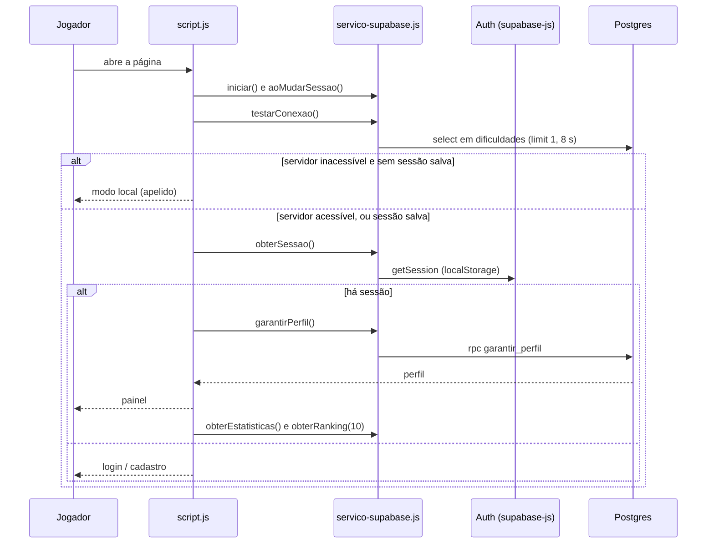
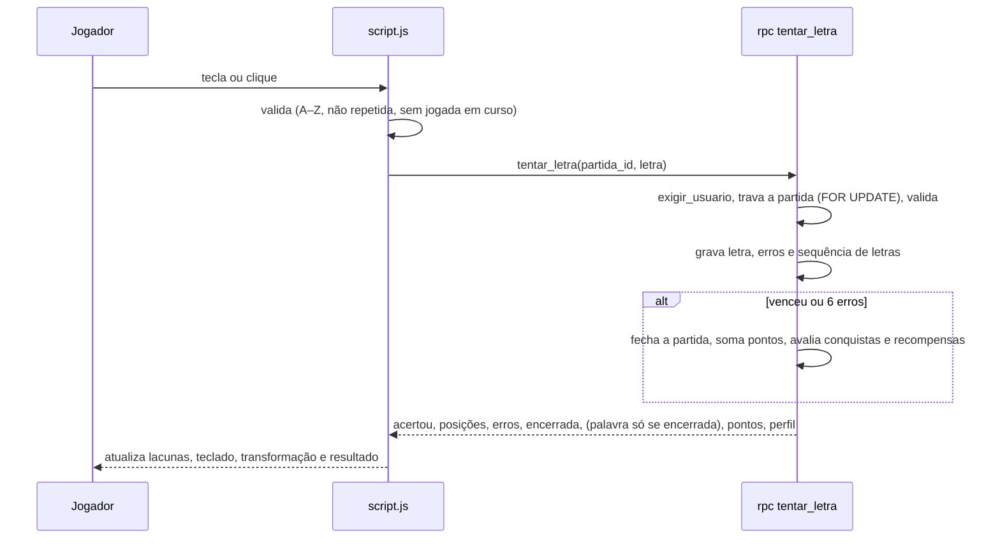
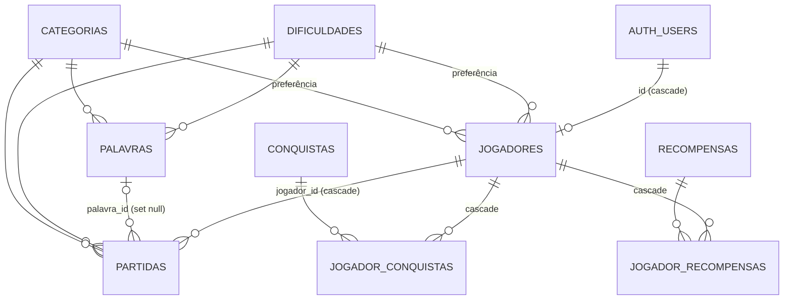

# Arquitetura

Visão técnica do Forca Gama: componentes, fluxos, modelo de dados e contrato entre o navegador e o banco. O **porquê** das decisões está nos ADRs ([adr/](adr/README.md)); o **que** o sistema faz está em [REQUIREMENTS.md](REQUIREMENTS.md); permissões e segredos em [SECURITY.md](SECURITY.md).

## Componentes

```text
Navegador                              Supabase (sa-east-1)
┌──────────────────────────┐          ┌─────────────────────────────────┐
│ index.html / style.css   │          │ Auth: e-mail e senha            │
│ config.js  (URL + chave  │          │ PostgREST ── RPC e tabelas      │
│            publishable)  │  HTTPS   │ Postgres: tabelas com RLS,      │
│ servico-supabase.js ─────┼─────────▶│   funções SECURITY DEFINER,     │
│   (único cliente)        │          │   schema "interno" (fechado)    │
│ script.js: interface,    │          └─────────────────────────────────┘
│   autenticação, motorOnline
│   e motorLocal (fallback)│          GitHub Pages ── serve os 5 arquivos
└──────────────────────────┘          jsDelivr ───── serve o supabase-js 2.117.2
```

| Camada | Arquivo | Responsabilidade |
|---|---|---|
| Estrutura e visual | `index.html`, `style.css` | Telas (carregando, autenticação, identificação local, painel, partida, resultado, modal) alternadas pelo atributo `hidden`. |
| Configuração | `config.js` | `window.FORCA_CONFIG` com URL do projeto e chave publishable. |
| Acesso ao Supabase | `servico-supabase.js` | Cria o **único** cliente; autenticação; chamadas às RPCs; leitura de histórico e escrita de preferências. Só transporte, sem regra de negócio. |
| Aplicação | `script.js` | Catálogos locais, perfil, autenticação, os dois motores de partida, progressão, interface e eventos. |
| Regras e dados | `supabase/migrations/` | Esquema, RLS, grants, trigger de perfil, RPCs e catálogo. É a fonte de verdade das regras. |

O sistema não tem build nem dependências npm. Só o `supabase-js` vem de um CDN.

## Dois motores, um contrato

`script.js` fala com um "motor" que expõe `iniciarPartida(dificuldade, categoria)` e `tentarLetra(partidaId, letra)` e devolve o mesmo formato das RPCs:

- **`motorOnline`** repassa para `ServicoOnline` → RPCs `iniciar_partida` e `tentar_letra`. O servidor sorteia a palavra, valida a letra, calcula pontos e progressão.
- **`motorLocal`** roda no navegador (fallback): palavra de `BANCO_DE_PALAVRAS`, progresso no `localStorage`, ranking e atividade simulados (`DADOS_MOCK`).

A interface não sabe qual roda. Consequência assumida: **as regras existem em dois lugares** (ver [adr/0003](adr/0003-front-end-estatico-com-modo-local.md) e [TECH_DEBT.md](TECH_DEBT.md)).

## Fluxos principais

### Abertura da página



Com sessão salva e servidor inacessível, a interface **não** cai no modo local: mostra "Tentar novamente".

### Uma jogada



### Cadastro e perfil

1. `signUp` envia e-mail, senha e `display_name` nos metadados.
2. Um trigger `AFTER INSERT` em `auth.users` cria a linha de `public.jogadores` (nome normalizado; nunca bloqueia o cadastro: em caso de falha só emite aviso).
3. Com confirmação de e-mail ligada, não há sessão até o jogador abrir o link do e-mail; o link devolve o jogador à página, onde o `supabase-js` lê a sessão da URL.
4. Em todo login, `garantir_perfil()` cria o perfil se faltar (idempotente) e o devolve.

## Modelo de dados



| Tabela | Papel |
|---|---|
| `dificuldades`, `categorias`, `conquistas`, `recompensas` | Catálogos (leitura pública). `dificuldades` guarda multiplicador, base de pontos e pontos cognitivos. |
| `palavras` | Banco de palavras (`^[A-Z]{2,30}$`, flag `ativa`); sem acesso do cliente. |
| `jogadores` | Perfil e progressão; `id` = `auth.users.id`; `nivel` é coluna gerada (`pontuacao / 300 + 1`). |
| `partidas` | Histórico e partida em andamento; guarda a palavra secreta (ilegível ao cliente) e `modalidade` (padrão `forca`). Índice único: no máximo uma partida `em_andamento` por jogador. |
| `jogador_conquistas`, `jogador_recompensas` | Progressão (a recompensa tem variante `base` ou `evolucao`). |

Excluir o usuário em `auth.users` remove perfil, partidas e progressão em cascata. O esquema `interno` guarda funções auxiliares e não é exposto pela API.

## Contrato das RPCs

Todas retornam JSON (exceto `obter_ranking`, que retorna linhas) e só são executáveis por `authenticated`. "Perfil" é a linha de `jogadores` acrescida de `conquistas` (ids), `recompensas` (`id-variante`) e `ultima_partida_em`.

| RPC | Entrada | Saída | Erros |
|---|---|---|---|
| `garantir_perfil()` | — | Perfil (cria se faltar; atualiza `visto_em`) | `28000` |
| `obter_perfil()` | — | Perfil (atualiza `visto_em`; serve de "batimento" de presença) | `28000` |
| `iniciar_partida(p_dificuldade, p_categoria)` | dificuldade e categoria | `partida_id`, `tamanho`, `dificuldade`, `categoria`. Abandona a partida aberta anterior e grava a preferência no perfil. | `28000`; `P0002` perfil inexistente; `22023` sem palavras |
| `tentar_letra(p_partida_id, p_letra)` | id da partida e letra | Letra repetida: `repetida: true`, `letra`, `erros`, `status`. Caso normal: `acertou`, `posicoes` (base 0), `erros`, `status`, `encerrada`, `venceu`, `palavra` (**só** se encerrada), `pontos`, `pontos_cognitivos`, `novidades`, `jogador` (perfil). | `28000`; `22023` letra inválida ou partida encerrada; `P0002` partida inexistente ou de outro jogador |
| `obter_ranking(p_limite)` | limite (1 a 50, padrão 10) | `posicao`, `nome`, `pontuacao`, `nivel`, `eh_voce` | — |
| `obter_estatisticas()` | — | `online`, `total_jogadores`, `online_por_categoria`, `media_por_categoria`, `palavras` (contagem por dificuldade e categoria) | — |

Além das RPCs, o cliente usa diretamente: `select` em `dificuldades` (teste de conexão), `update` das próprias preferências em `jogadores` e `select` das próprias partidas concluídas (colunas permitidas, sem a palavra). Autenticação usa o `supabase-js` (`signUp`, `signInWithPassword`, `signOut`, `getSession`, `onAuthStateChange`).

### Contrato de erros (acoplamento a respeitar)

A interface decide pelo **código** (e, num caso, pelo **texto**) do erro; mudar a mensagem no SQL exige mudar o tratamento em `script.js`:

| Situação | Como o cliente reconhece | Reação |
|---|---|---|
| Sessão inválida ou expirada | status 401, código `28000`, `PGRST301`, `PGRST303`, `AuthSessionMissingError` ou "JWT" na mensagem (`erroDeSessao`) | Volta ao login: "Sua sessão expirou." |
| Falha de rede | `TypeError`, `AbortError`, `TimeoutError`, `AuthRetryableFetchError`, status 0, ou erro sem código cuja mensagem cita fetch/network/timeout/abort (`erroDeRede`) | "Sem conexão…" e "Tentar novamente"; a letra não é registrada |
| Partida já encerrada no servidor | código `22023` **e** mensagem contendo "encerrada" | Sincroniza o perfil e avisa (`sincronizarPartidaEncerrada`) |
| Erros de autenticação | códigos do Auth (`invalid_credentials`, `email_not_confirmed`, `weak_password`, `over_*_rate_limit`…) | Mensagens traduzidas (`traduzirErroDeAutenticacao`) |

## Robustez no cliente

- Chamadas ao servidor têm limite de 8 s (`AbortSignal.timeout`).
- `estadoDaPartida.rodada` e `geracaoSessao` descartam respostas atrasadas de partidas abandonadas ou de sessões encerradas; `aguardando` impede duas jogadas simultâneas.
- No servidor, `FOR UPDATE` serializa jogadas na mesma partida e o índice único impede duas partidas abertas.
- O callback de `onAuthStateChange` não chama o Supabase de forma síncrona (risco de deadlock documentado); o trabalho é agendado com `setTimeout`.

## Implantação

Site estático no GitHub Pages e migrations aplicadas por workflow ao mesclar na `main`: ver [DEPLOYMENT.md](DEPLOYMENT.md).
